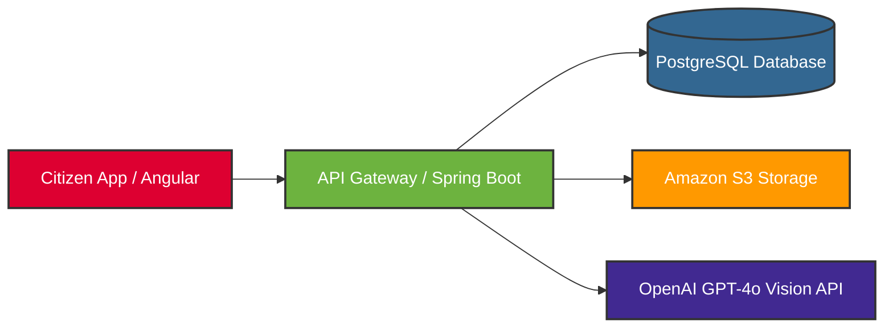

# Vadhuvai (வதுவை) 💍

> **"வதுவை நன்மணம் கழிந்த பின்றைக், கல்லென் சும்மையர்..." — Agananuru 86 (Author: Nallavur Kizhar)**
> *"After the four noble mothers complete the wedding rituals... the formal Vadhuvai (marriage ritual) comes to a close."*

**Vadhuvai (வதுவை)** is an enterprise-grade, open-source marriage registration platform designed to eliminate the exhausting "pillar-to-post" bureaucracy found in traditional civil registries. Named after the ancient Sangam Tamil word for public marriage ceremonies, this project transitions legal union recording from outdated paper-pushing to a secure, digital-first infrastructure.

---

## 💻 Background & The Problem

In today's digital age, registering a marriage still feels trapped in the past. Citizens are forced to physically navigate complex government offices, manage endless paperwork, secure multiple physical appointments, and bring several witnesses just to receive a physical piece of paper. If lost, replacing it triggers another bureaucratic nightmare.

Because India is culturally diverse, marriage rituals are legally governed by multiple constitutional acts:
*   **Hindu Marriage Act, 1955**
*   **Special Marriage Act, 1954**
*   **Muslim Personal Law (Shariat Application Act, 1937)**
*   **Indian Christian Marriage Act, 1872**
*   **Parsi Marriage and Divorce Act, 1936**

While the customs differ, every citizen ultimately lands at the Sub-Registrar Office (SRO) to legally validate their marriage for essential milestones like passports, visas, and legal identity verification. **Vadhuvai** completely automates this common backend bottleneck.

---

## 💡 Proposed Solution & Workflow

Vadhuvai reimagines the workflow by keeping the bulk of the administrative burden online, reducing physical visits to just a single final biometric touchpoint.

1.  **Citizen Login:** Secure authentication portal for applicants.
2.  **OCR Verification:** Immediate verification of critical identity documents (Aadhaar, Passports, Age proof).
3.  **Gateway Payment:** Seamless integration for statutory government registration fees.
4.  **SRO Portal & Approval:** A dedicated dashboard for Sub-Registrar Officers to audit and approve verified applications.
5.  **Single-Visit Biometric Touchpoint:** One final, brief physical visit to capture biometrics and conclude identity checks.
6.  **Digital Certificate Generation:** Instant creation of a cryptographically signed, secure digital marriage certificate.

---

## 🛠 Tech Stack

The architecture is built using robust, scalable, and industry-standard technologies:

*   **Frontend:** Angular (For a modular, responsive single-page application experience)
*   **Backend:** Java Spring Boot (For enterprise-level security, transaction handling, and scalability)
*   **Database:** PostgreSQL (For secure relational mapping of citizen records)
*   **Storage & AI:** Amazon S3 (For encrypted document storage) + OpenAI GPT-4o Vision API (For automated document parsing and smart OCR verification)

---

## 🗺 System Architecture

---
## 🚀 Getting Started & Next Steps

This repository marks the initial phase of the Vadhuvai system. The implementation roadmap is split as follows:

*   **Phase 1:** Citizen onboarding, document upload workflows, and OpenAI-driven OCR verification.
*   **Phase 2:** SRO Admin Dashboard with real-time application auditing tools.
*   **Phase 3:** Cryptographic PDF generation for digital certificates and payment gateway integration.

---

## 🤝 Contributing

As an open-source initiative aimed at updating public digital infrastructure, contributions from developers, UI/UX designers, and tech-policy enthusiasts are highly welcome!

1.  **Fork** the repository.
2.  Create your feature branch (`git checkout -b feature/AmazingFeature`).
3.  Commit your changes (`git commit -m 'Add some AmazingFeature'`).
4.  Push to the branch (`git push origin feature/AmazingFeature`).
5.  Open a **Pull Request**.

